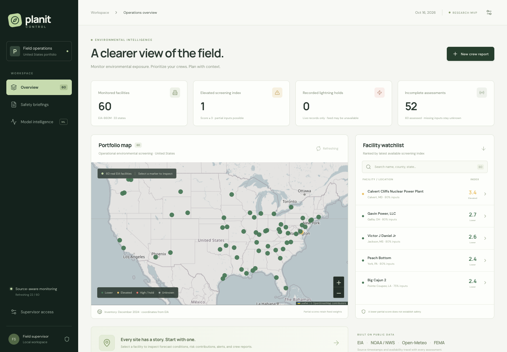

# PlanIT Control

Environmental safety intelligence for utility construction supervisors. This local research MVP maps **60 genuine EIA power plants across 33 states**, combines public environmental feeds into an inspectable screening index, runs historically trained flood/storm classifiers, and persists crew reports and next-day briefings.



This is decision support for human review. The index is not an injury probability, a low score is not clearance, and missing lightning observations do not establish safe conditions. Live provider records and explicitly labeled replay strikes are separate.

## Start locally

Requirements: Python 3.12, Node.js 22.12 or newer, npm, and internet access for environmental feeds and map tiles. The selected model, evaluation, training table, and facility inventory are included. Downloading the historical archives is unnecessary to launch.

Run from the repository root:

```sh
python3.12 -m venv .venv
.venv/bin/python -m pip install -r requirements.txt
npm --prefix frontend ci
npm --prefix frontend run build
```

On macOS, LightGBM may require the OpenMP runtime (`brew install libomp`) if importing it reports a missing `libomp.dylib`. Do not substitute a different classifier to hide an installation failure.

Create configuration once; this command deliberately fails if `.env` already exists:

```sh
.venv/bin/python - <<'PY'
from pathlib import Path
import secrets
configuration = Path('.env.example').read_text().replace('change-this-local-token', secrets.token_urlsafe(32))
with open('.env', 'x') as output:
    output.write(configuration)
Path('.env').chmod(0o600)
PY
```

Edit `PLANIT_USER_AGENT` in `.env` to include your real contact address for NWS requests. Keep the supervisor token private. Then run **one worker**, from this directory:

```sh
.venv/bin/python -m uvicorn backend.main:app --env-file .env --host 127.0.0.1 --port 8000
```

Open `http://127.0.0.1:8000`. First-time assessments populate progressively; unavailable sources are shown explicitly. Open **Supervisor access** and enter your local `PLANIT_ADMIN_TOKEN` to enable reports, review, refresh, replay, and manual briefing generation. It is stored in browser session storage. API documentation is at `/docs`; health and refresh progress are at `/api/health`.

For frontend development, keep the backend running and run `npm --prefix frontend run dev` in another terminal. Vite proxies `/api` and `/uploads` to port 8000. Rebuild the frontend before using the backend's production page; restart the backend after its first build so it mounts the compiled assets.

## What works

- Leaflet map, ranked facilities, source timestamps, warning details, responsive site panels, index contributions, and locally accumulated score history.
- Open-Meteo modeled weather, forecast rainfall and shallow soil moisture; active point-matched NWS alerts; FEMA mapped flood exposure.
- Separate flood and severe-storm classifiers benchmarked against XGBoost, LightGBM, and logistic regression, calibrated on a separate period. Logistic regression won both validation comparisons.
- Recorded-strike stop-work timers within 10 miles, reset to 30 minutes after the latest qualifying strike; independent labeled replay controls.
- Geolocated photo reports, persistent review status, and verified-report index contributions.
- Persistent, idempotent next-day briefings scheduled after 18:00 in each facility's IANA timezone, plus an immediately testable generation button.

Heat, rain, and soil values are screening inputs. Wildfire coverage is limited to relevant NWS alerts and crew reports; wildlife comes from crew reports. There is no active-fire perimeter feed. A commercial live lightning feed has not been connected. No verified Jev integration was available in this implementation; reports use explicit manual classification.

## Evidence and reproduction

The benchmark uses 8,532 complete county-days from twelve counties in 2024–2025. On the held-out 2025 regional test:

| Selected model | Precision | Recall | PR-AUC | ROC-AUC | Brier | False alerts /100 county-days |
|---|---:|---:|---:|---:|---:|---:|
| Flood · logistic | 0.052 | 0.782 | 0.144 | 0.801 | 0.0235 | 36.01 |
| Storm · logistic | 0.074 | 0.670 | 0.109 | 0.791 | 0.0275 | 24.13 |

Low precision means many alerts are false positives. These are county-event labels, not verified facility incidents. Geographic transfer is weak; the held-out Los Angeles storm test has zero recall at the selected threshold. Most nationwide plants are outside the small training region and their predictions are excluded from the index.

```sh
.venv/bin/python -m pytest -q
npm --prefix frontend run build
# Retrain using the included training table; overwrites the saved model and evaluation:
.venv/bin/python -m scripts.train
# Rebuild public source datasets, requiring network access:
.venv/bin/python -m scripts.ingest_sites
.venv/bin/python -m scripts.build_training
.venv/bin/python -m scripts.train
```

Raw downloads are cached under `data/raw/` with URL, retrieval timestamp, byte count, and SHA-256 manifests. Committed provenance describes the artifacts used for the measured result. A fresh NOAA archive listing can select a newer source revision and change results; retain raw files and manifests for byte-for-byte source reproducibility. Training uses fixed seeds and pinned direct Python dependencies, but numerical results can vary slightly across platforms/native libraries. Load only trusted joblib artifacts. Restart the backend after replacing a model because it caches the artifact in process.

## Project guide

| Location | Responsibility |
|---|---|
| `frontend/src/main.tsx`, `styles.css` | Dashboard, map, forms, evaluation and briefing views |
| `backend/main.py` | API, validated mutations, assessments, scheduler, optional delivery |
| `backend/domain.py` | Pure index, distance, lightning and local-time rules |
| `backend/providers.py` | Public feeds, retries, freshness and failed-fetch cooldown |
| `backend/predict.py` | Saved-model inference and reference-feature sensitivity |
| `backend/store.py` | Canonical SQLite schema and transactions |
| `scripts/ingest_sites.py` | Genuine EIA inventory extraction and validation |
| `scripts/build_training.py`, `train.py` | Archived predictors, NOAA labels and measured benchmark |
| `data/`, `models/` | Committed inventory, training data, provenance and trained artifacts |
| `tests/` | Critical domain, API, persistence, provider and dataset checks |

Read [sources and licensing](docs/SOURCES.md), [model methodology](docs/MODEL_CARD.md), [operations and API](docs/OPERATIONS.md), [generated evaluation](docs/EVALUATION.md), and the [demo and verification record](docs/DEMO.md). `PLAN.md` records milestone completion.

## Deployment boundary

The canonical deployment is a local single-supervisor process bound to loopback. Reads, uploaded photos and API docs have no authentication; the shared supervisor token is not a multi-user identity system. There is no TLS termination, account management, audit log, distributed scheduler, retention policy, or production abuse protection. Do not expose this service publicly without designing those controls.

Free Open-Meteo service is for noncommercial use and has request limits; commercial utility use requires appropriate service terms. Public OSM tiles are a community service, not a production SLA. Webhook delivery and real strike ingestion require separately configured services and have not been tested against an external provider. No paid service or public deployment was used.
