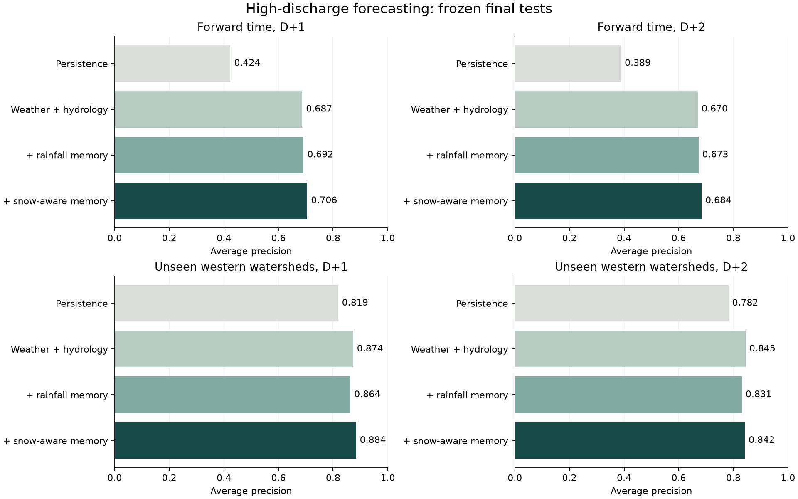

# Forecast-memory hydrology research

The selected snow-aware LightGBM models improve high-discharge ranking over lagged-flow persistence on independent forward-time and western-watershed tests. The experiment does **not** establish that snow-aware memory adds reliable value over weather plus hydrology. Its incremental AP intervals include zero, and alert thresholds calibrated to a 1% validation false-alert budget produce more false alerts on the final tests. Keep every candidate experimental. Production models and safety rules are unchanged.

This study predicts daily discharge above a historical percentile. It does not predict an official flood stage, inundated infrastructure, or worker danger. The earlier [flood-stage feasibility audit](FLOOD_SPRINT_RESULTS.md) still applies: historical threshold and gauge-reference validity remain unresolved. Changing the target makes this a separate experiment, not a way to pass that audit.

## Research design and contribution

The [frozen protocol](HYDROLOGY_RESEARCH_PROTOCOL.md) defines the population, targets, feature recipes, splits, calibration, selection, uncertainty tests and stop rules. It was committed before model fitting. A [pre-model quality amendment](HYDROLOGY_RESEARCH_AMENDMENT.md) bounds the handling of small negative archived precipitation values. Registry, protocol and production-artifact hashes live in [`protocol.json`](../experiments/sprint-20261017-hydrology/protocol.json). Model selection and thresholds were committed in `3d9cea2` before final evaluation.

The research contribution is a reproducible comparison of forecast-driven hydrological memory at locations excluded from fitting. Parallel rainfall reservoirs and a snow-storage proxy supply causal memory to a pooled classifier. The experiment tests whether those features earn their complexity through paired ablations. It does not claim to invent hydrological reservoirs, mass conservation, or a state-of-the-art architecture.

### Literature and alternatives

| Primary source | Relevant finding or implementation | Decision for this experiment |
| --- | --- | --- |
| Shalev and Kratzert, [Caravan MultiMet](https://arxiv.org/abs/2411.09459), and the [official Caravan example](https://github.com/kratzert/Caravan/blob/main/examples/Caravan_MultiMet_Extending_Caravan_with_Multiple_Weather_Nowcasts_and_Forecasts.ipynb) | Basin-averaged operational weather forecasts support forecast-based hydrology research. The archive ignores dissemination delays. | Use bounded HRES chunks and explicitly conditional availability assumptions. |
| Kratzert et al., [Towards learning universal, regional, and local hydrological behaviors via machine learning](https://hess.copernicus.org/articles/23/5089/2019/) | Regionalized LSTMs learn transferable hydrological behavior across catchments. | Use pooled models, basin attributes and held-out drainage regions before considering a larger recurrent network. |
| Hoedt et al., [MC-LSTM implementation](https://github.com/ml-jku/mc-lstm) | A mass-conserving recurrent structure supplies a physical inductive bias. | Test a small snow-storage and reservoir feature bank. It conserves only the proxy snow store, not total catchment water. |
| Nearing et al., [global streamflow study implementation](https://github.com/google-research-datasets/global_streamflow_model_paper) | Cross-basin extreme-flow evaluation needs explicit label and time conventions. The implementation documents restricted GRDC observations and large-memory workflows. | Do not download restricted observations or reproduce the documented 128 GB notebook on this machine. The publisher page returned a challenge rather than the paper text; the review used the official implementation. |
| [NeuralHydrology](https://github.com/neuralhydrology/neuralhydrology) | An established implementation for recurrent hydrology experiments. | No framework installation or LSTM training. The frozen memory ablation is already inconclusive against the strong combined baseline. Further architecture selection on these tests would invalidate them. |
| [NOAA NWM retrospective archive](https://registry.opendata.aws/nwm-archive/) | Retrospective simulations use retrospective forcings. | Do not label a retrospective simulation an as-issued authoritative forecast. A historical issued-discharge comparator remains absent. |

Exact research response URLs, retrieval times and hashes are in `experiments/sprint-20261017-hydrology/research/*.request.json`. Raw research documents remain local. No network citation or claimed result depends on an uninspected paper body. Graph models were not justified without an audited river graph and upstream availability history. Satellite features remain excluded because basin alignment and historical publication validity have not been certified. No advisory Jev calls were made.

## Data, target and coverage

The sources are Caravan MultiMet v1.1 HRES basin-average precipitation and temperature, USGS daily mean discharge, and USGS station metadata. MultiMet is distributed under CC BY 4.0; retain its attribution and the original ECMWF source attribution. USGS measurements and metadata are public US government data. No Kaggle, synthetic training data, paid dataset, checkpoint, or API key is involved.

The decoded HRES coordinates span January 1, 2016 through September 30, 2024. Downloading individual compressed Zarr chunks avoids the approximately 10 GB forecast and 29 GB Caravan bundles. The source cache holds 196,724,632 bytes. The compressed feature table holds 72,578,271 bytes. The complete local experiment occupied about 292 MB before the report figure. These are measured local sizes, not estimates of a future deployment.

USGS requests cover January 1, 2000 through September 30, 2024. Labels use parameter 00060, statistic 00003, in cubic feet per second. Only finite, nonnegative observations with the exact quality code `A` are accepted. Estimated `A:e`, provisional, ice and missing records do not become negatives. The reference threshold is each station's accepted 2000-2015 95th percentile, requiring at least 3,000 reference days. The target is a strictly greater daily mean. Approved discharge can still contain measurement and rating-curve error.

The registry selects 96 stations using metadata before collecting their outcomes, with one station per HUC4. Development excludes HUC2s 03, 12, 17 and 18. Geographic validation uses 03 and 12; geographic testing uses 17 and 18. The connected Mississippi drainage regions remain in development. HUC separation is a drainage screen, not proof against every interbasin transfer.

Three gauges fail reference coverage: 04127918, 05120500 and 06746095. Gauge 12010000 returns two mean-discharge series and is excluded without guessing. Three otherwise eligible gauges have no complete common rows: 02342933, 03338780 and 04161580. No replacements were selected. The resulting 391,435 decisions across both horizons contain 89 gauges: 55 development, 17 geographic validation and 17 geographic test. Missing observations and the common complete-input requirement change coverage across years.

[`provenance.json`](../experiments/sprint-20261017-hydrology/provenance.json) owns the source manifest, exclusions, references and truncation counts. [`coverage.csv`](../experiments/sprint-20261017-hydrology/coverage.csv) records rows, positive days and certified onsets by station, year and horizon. No station identifier or HUC enters a fitted model.

| Cohort | D+1 decisions | Positive days | Certified onsets | Gauges | D+2 decisions | Positive days | Certified onsets | Gauges |
| --- | ---: | ---: | ---: | ---: | ---: | ---: | ---: | ---: |
| Fit, 2017-2020 | 56,739 | 4,598 | 705 | 54 | 56,549 | 4,566 | 703 | 54 |
| Calibrate, 2021 | 13,421 | 473 | 132 | 51 | 13,375 | 475 | 132 | 51 |
| Development selection, 2022 | 13,220 | 449 | 113 | 51 | 13,178 | 444 | 111 | 51 |
| Geographic selection, 2022 | 5,515 | 195 | 59 | 17 | 5,514 | 195 | 59 | 17 |
| Forward final, 2023-2024 | 24,915 | 1,432 | 240 | 52 | 24,830 | 1,427 | 236 | 52 |
| Geographic final, 2023-2024 | 9,006 | 1,197 | 78 | 17 | 8,981 | 1,196 | 79 | 17 |

Onsets require seven preceding accepted below-threshold days. They count certified starts, not every high-flow day or every flood. Missing days prevent certification. Final tests cover January 8, 2023 through September 28, 2024. The geographic final gauges are excluded from model fitting, calibration and selection. Earlier discharge history at those gauges defines their thresholds and lagged inputs, so this is transfer to historically gauged watersheds, not truly ungauged prediction.

## Features, availability and models

At decision day D, 00:00 UTC, weather features use the HRES run dated D-1, leads 2-5. Memory uses lead-1 forecasts dated no later than D-2, with 270 consecutive complete days required. Hydrology uses D-3, D-4, D-7 and D-14 local daily means divided by the fixed historical reference and transformed with `log1p`, plus a recent-change feature. Static inputs are latitude, longitude, log drainage area and elevation; season uses sine and cosine. The primary target is local day D+1, and the secondary target is D+2.

Rainfall memory has fixed 2, 7, 30 and 90-day exponential time constants. The snow-aware alternative stores precipitation when forecast temperature is at or below zero, then releases at most 3 mm per positive degree C per day. Liquid precipitation plus melt drives the same memory bank. These are forecast-derived proxies. There is no observed snow, evapotranspiration or groundwater model, and parallel memory filters cannot be summed as physical water stores.

The three-day discharge lag and full-day forecast buffer are conservative assumptions. The archive does not prove each historical observation or forecast was received before its decision time. Approved USGS observations may have been revised. Results therefore apply to a reconstructed-input comparison, conditional on these availability assumptions. They do not establish an as-issued operational replay. A more current discharge baseline could be substantially stronger than the deliberately delayed persistence benchmark.

Logistic regression, XGBoost and LightGBM each evaluate weather, hydrology and their combination. LightGBM also evaluates rainfall memory and snow-aware memory. Calibrated persistence, rainfall ranking and seasonal climatology complete 28 candidates across two horizons. Fixed recipes and two-thread isolated workers avoid parameter search and mixed boosting runtimes. Each probability calibrator uses development gauges in 2021 only.

Equal-weight development and geographic-validation AP selects `lightgbm_snow_h1` and `lightgbm_snow_h2`. Their selection APs are 0.4247 and 0.3958. The preselected strongest combined comparators are LightGBM for D+1 and XGBoost for D+2. No model, threshold or feature was changed after final evaluation.

## Independent results

AP is average precision. Higher is better, but AP changes with prevalence and must be compared within a column. Geographic final prevalence is about 13.3%, versus about 5.7% in forward testing. These columns do not establish that geographic transfer is easier than forward prediction.

| Candidate | Forward D+1 AP | Geographic D+1 AP | Forward D+2 AP | Geographic D+2 AP |
| --- | ---: | ---: | ---: | ---: |
| Persistence | .4242 | .8190 | .3888 | .7820 |
| Forecast rainfall | .0849 | .2074 | .0857 | .2131 |
| Seasonal climatology | .1110 | .2739 | .1109 | .2746 |
| Logistic, weather | .2383 | .3113 | .2410 | .3245 |
| Logistic, hydrology | .5152 | .8249 | .4898 | .7929 |
| Logistic, combined | .5708 | .8387 | .5528 | .7996 |
| XGBoost, weather | .3267 | .4487 | .3349 | .4678 |
| XGBoost, hydrology | .6147 | .8394 | .5865 | .8064 |
| XGBoost, combined | .6907 | .8713 | .6679 | .8401 |
| LightGBM, weather | .3171 | .4590 | .3224 | .4695 |
| LightGBM, hydrology | .6125 | .8400 | .5845 | .8059 |
| LightGBM, combined | .6874 | .8737 | .6702 | .8450 |
| LightGBM, rainfall memory | .6919 | .8636 | .6725 | .8313 |
| LightGBM, snow-aware memory, selected | .7056 | .8842 | .6840 | .8424 |



### Calibration, alerts and useful lead

Alert thresholds are frozen from pooled 2022 selection at budgets of 1 and 5 false alerts per 100 decisions. The next table uses the 1% selection budget. These are not matched *realized test* false-alert rates, so recall differences must be read beside the false-alert column. Thresholds were not adjusted to repair the test budget.

| Test and model | Brier | Precision | Recall | False alerts per 100 decisions | Certified onset recall |
| --- | ---: | ---: | ---: | ---: | ---: |
| Forward D+1, persistence | .0469 | .614 | .233 | .843 | .000 |
| Forward D+1, selected | .0281 | .711 | .593 | 1.385 | .188 |
| Geographic D+1, persistence | .0880 | .906 | .424 | .588 | .000 |
| Geographic D+1, selected | .0372 | .770 | .837 | 3.331 | .295 |
| Forward D+2, persistence | .0480 | .561 | .177 | .797 | .000 |
| Forward D+2, selected | .0292 | .708 | .560 | 1.329 | .123 |
| Geographic D+2, persistence | .0916 | .890 | .373 | .612 | .000 |
| Geographic D+2, selected | .0420 | .743 | .819 | 3.775 | .342 |

The selected models' geographic false-alert rates exceed the 1% selection budget by more than threefold. Their 5% budget thresholds produce geographic false-alert rates of 7.006 and 7.716 per 100 decisions, with onset recall .731 and .646. Good pooled ranking does not guarantee an acceptable operating point.

Selected-model geographic D+1 Brier is .0372, compared with .0411 for LightGBM combined. For D+2 it is .0420, compared with .0455 for the preselected XGBoost combined comparator. Ten fixed reliability bins, log loss and both alert budgets are retained for every candidate, gauge and HUC2 in the family evaluation JSON files. Calibration is not uniformly reliable: in the geographic D+1 bin with mean prediction .549, the observed frequency is .411 across 95 decisions.

Primary target days begin 28-32 hours after issue across the forward test, or 30-32 hours in the western geographic test. Secondary days begin 52-56 or 54-56 hours after issue. Primary daily means end 52-56 hours after issue, secondary means 76-80 hours. DST is accounted for. These are lead times to a daily-mean target window; the experiment cannot locate the first instantaneous dangerous crossing. Low onset recall at strict alert thresholds is a material limitation.

### Geographic transfer and ablations

The selected D+1 model's macro station AP is .7903 in geographic testing, versus .8842 pooled AP. D+2 macro AP is .7652, versus .8424 pooled. Per-station AP is undefined for single-class slices and explicitly null in the JSON. D+1 geographic station AP ranges from .4957 to .9914. Aggregate performance does not describe every river.

| Geographic region | D+1 positive days / decisions | Selected D+1 AP | D+1 false alerts /100 | Selected D+2 AP | D+2 false alerts /100 |
| --- | ---: | ---: | ---: | ---: | ---: |
| HUC2 17, Pacific Northwest | 303 / 4,854 | .6656 | 3.131 | .6167 | 3.306 |
| HUC2 18, California | 894 / 4,152 | .9453 | 3.565 | .9223 | 4.322 |

California's high prevalence and prolonged high-flow periods contribute to the strong pooled score. No conclusion about transfer to Florida, urban drainage, regulated rivers or utility work sites follows from this test.

Rainfall memory improves forward AP slightly but reduces geographic AP at both horizons relative to LightGBM combined. Snow-aware memory improves D+1 AP in both tests. At D+2 it improves forward AP but trails LightGBM combined geographically by .0026, while exceeding the preselected XGBoost comparator by .0023. The final tests did not trigger reselection. Snow-aware memory improves geographic station AP over LightGBM combined at 16 of 17 stations for D+1 and 14 of 17 for D+2; 10258000 regresses at both horizons. These are descriptive ablations, not independent confirmation of a mechanism.

### Paired uncertainty

Intervals use 500 seeded paired bootstrap resamples, once by HUC4 clusters and separately by calendar-month blocks. The table gives the 2.5th and 97.5th percentiles of the AP difference. They are dependence sensitivity analyses, not proof of independent observations. Both intervals and the paired recall differences at frozen 1% thresholds are in [`uncertainty.json`](../experiments/sprint-20261017-hydrology/uncertainty.json).

| Selected model minus comparator | Test | HUC4 AP difference interval | Month AP difference interval |
| --- | --- | --- | --- |
| D+1 minus persistence | Forward | [.2169, .3367] | [.1920, .3451] |
| D+1 minus persistence | Geographic | [.0314, .1320] | [.0263, .1289] |
| D+1 minus combined LightGBM | Forward | [.0027, .0373] | [-.0003, .0396] |
| D+1 minus combined LightGBM | Geographic | [-.0069, .0441] | [.0013, .0222] |
| D+2 minus persistence | Forward | [.2273, .3548] | [.2047, .3514] |
| D+2 minus persistence | Geographic | [.0157, .1482] | [.0070, .1426] |
| D+2 minus combined XGBoost | Forward | [.0014, .0342] | [-.0051, .0377] |
| D+2 minus combined XGBoost | Geographic | [-.0230, .0415] | [-.0090, .0192] |

The frozen incremental-value requirement fails against the strongest combined baseline. Positive point estimates cannot substitute for positive lower bounds in both tests under both resampling methods. There is enough certified-event coverage to evaluate the hypotheses; the result is inconclusive incremental memory value, not an insufficient-event excuse.

## Reproduction, resources and verification

From the repository root, the following are the executed commands. Collection needs network access and a fresh experiment directory; selection and final evaluation deliberately refuse overwriting frozen outputs. Do not delete the existing artifacts to tune against these tests.

```sh
uv pip install --python .venv/bin/python -r experiments/sprint-20261017-hydrology/requirements.txt
.venv/bin/python -m scripts.hydrology_research collect
.venv/bin/python -m scripts.hydrology_research select
# Commit selection before opening final results.
.venv/bin/python -m scripts.hydrology_research evaluate
.venv/bin/python -m scripts.report_hydrology
.venv/bin/python -m pytest -q
npm --prefix frontend run build
```

The isolated experiment uses Python 3.12, NumPy 2.2.6, pandas 2.3.3, scikit-learn 1.8.0, XGBoost 3.2.0, LightGBM 4.6.0 and joblib 1.5.3. The added decoder dependency is pinned separately to numcodecs 0.16.5; it does not enter production requirements. Family selection JSON files record exact package versions, candidate times, artifact checksums and process resources. `selection.json` pins the dataset and both model-pipeline source files. No model-family process imports both boosting libraries.

| Isolated family | Fit, calibrate and select, seconds | Evaluate, seconds | Maximum worker RSS, MB |
| --- | ---: | ---: | ---: |
| Baselines | 1.58 | 3.39 | 801 |
| Logistic | 1.67 | 3.40 | 830 |
| XGBoost | 2.88 | 3.40 | 899 |
| LightGBM | 5.62 | 5.35 | 939 |

Times include each worker's data-loading work and exclude interpreter startup before its timer, network collection and the coordinator's bootstrap analysis. RSS is the maximum across selection and evaluation for that family, not total machine memory. Workers run sequentially with two threads, well below the 6 GB worker budget. No GPU, neural training or paid inference was used. Machine-wide swap and download wall time were not instrumented.

[`audit.json`](../experiments/sprint-20261017-hydrology/audit.json) records prediction-file hashes and confirms that all 56 aggregate evaluations reproduce from saved probabilities and match the frozen cohort identities. The audit reads probabilities with round-trip float parsing to preserve ties; ordinary CSV parsing can alter AP in the seventh decimal place. Reported four-decimal comparisons and uncertainty conclusions are unaffected. The model artifacts, feature table, raw responses and predictions remain local and ignored by Git; their hashes and measured results are committed. Re-downloading a revised upstream archive may not reproduce those exact bytes.

Seven focused tests cover observation quality and identity, causal feature availability, time representation, split embargoes, geographic roles, tied alert budgets, bounded negative precipitation, paired uncertainty and onset metrics. The full Python suite passes 167 tests, with three existing SHAP deprecation warnings. The frontend production build passes; Vite warns that Node 20.17.0 is below its supported minimum. Production model and static-data hashes match the frozen registry. No application database write, live dashboard change or model deployment is part of this experiment.

## Decision and strongest next step

Retain the production application unchanged. The selected candidates are useful research artifacts, and combined weather plus hydrology is a strong reference for the next study. There is no demonstrated reason to ship the extra memory features or to train a larger architecture on these final tests.

The next study should prospectively record immutable observation arrivals, issued weather forecasts, historical threshold contracts and an authoritative issued-discharge forecast where available. Compare against persistence using the most recent actually received gauge value. Freeze new catchments and future dates, then evaluate strict onset warnings and regional alert budgets. Include regulated rivers near the actual project locations. An upstream graph or learned recurrent store is justified only after those baselines expose a remaining predictive gap.

A path into the 0-10 hazard index requires a separate mapping from predicted high discharge to verified site exposure and operational consequences. Neither multiplying this probability by ten nor joining a gauge by proximity would establish that mapping. For the Sperry use case, public construction plans could eventually be associated with audited drainage and infrastructure exposure, but this study implements no such join and supports no claim that it predicts construction-site flooding.
