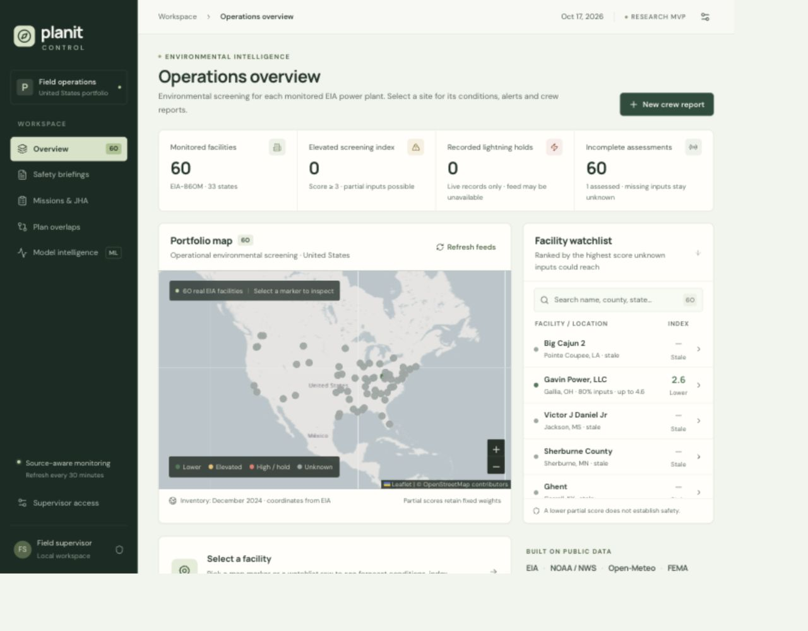

# Dashboard visual and responsive verification

Verified October 17, 2026 in the Codex in-app Browser against the production frontend build. This iteration keeps the existing routes, data contracts and actions. It introduces no frontend dependency.

## Changes

The interface uses a restrained forest, moss and warm off-white palette. Portfolio metrics share a divided strip, the watchlist has a clearer reading order, and mission memory and construction overlaps use flatter rows with explicitly named scores. Overlap factors remain available in a disclosure. Forms, condition summaries and detail panels stack at narrow widths. Active navigation and selected rows expose their state to assistive technology.

The portfolio map previously rebuilt its layers during recurring renders, including the one-second clock update, and could invalidate its pixel origin during a zoom. It now retains site and report marker identity, updates their data in place, and defers projection-affecting updates until movement finishes. Filtered reports are memoized. A shared resize observer coalesces callbacks and waits for map movement to finish before invalidating size without panning. Both maps use that observer and prevent repeated world tiles. Selecting a facility stops the previous flight and respects reduced-motion preference.

Browser verification also caught a long mobile breadcrumb pushing the settings button outside the page. The breadcrumb can now shrink and truncate while the settings control retains its space. Sidebar status text wraps rather than clipping at intermediate widths.

## Verification environment

The QA backend used a SQLite backup at `/tmp/planit-ui-sprint.sqlite`, with the scheduler disabled on port 8001. No crew report, mission, briefing, feed refresh, replay or Jev request was submitted during these UI checks. Existing copied assessments aged normally; stale/missing labels in screenshots are actual state, not fabricated fresh observations. The application's persistent database was not the QA write target.

The browser had 110% page zoom. Viewport overrides were adjusted to exercise the CSS widths below, confirmed using `innerWidth` and document scroll width. The overrides are temporary and were reset after verification.

| CSS viewport width | Checks | Result |
| ---: | --- | --- |
| 320 | Loaded mission detail and hazard memory; overlaps; model table; long navigation header | No horizontal page overflow after the header fix; evaluation table retains its own horizontal scrolling |
| 354 | Overview, selected facility, crew report dialog | Readable metric grid and vertically scrollable single-column form; controls fit |
| 390 | Overview and map after desktop resize | Document width 390; 60 site marker paths retained |
| 768 | Overlap summary, filters and map | Document width 768; no control/card overflow |
| 1024 | Evaluation view and sidebar | Document width 1024; sidebar status fits its bounds |
| 1280 | Overview, watchlist and map | Document width 1280; 60 site marker paths; no horizontal page overflow |

Repeated map zoom-in/out actions, facility selection, navigation away/back and resizing after a zoom showed settled pins aligned with the map. No transient displacement was seen during this manual pass. DOM checks confirmed all 60 site paths remained present; this is not a pixel-by-pixel animation test. The QA tab recorded no console warnings or errors.

## Reproducible checks

```sh
npm --prefix frontend test
npm --prefix frontend run build
.venv/bin/python -m pytest -q
```

The frontend test exercises the actual shared resize helper: coalescing, deferral through map movement, flushing after movement, observer disconnection and cancellation after removal. It uses Node's built-in test runner and type stripping. The final production build passes TypeScript and Vite compilation. The full backend suite passes 121 tests, including the 13 new isolated ML experiment checks.

For a manual repeat, open the production build, inspect each view at the widths above, select a facility, open and close the report form, zoom the portfolio map repeatedly, and resize during movement. Verify that controls remain reachable and page width matches the viewport. Do not submit forms merely to check layout.

## Screenshots and remaining limits



[Full mobile overview](../output/ui-sprint/mobile.jpg)

Safari, Firefox, physical touch devices and prolonged feed polling during gestures were not tested. Reduced-motion handling is implemented but was not exercised with an operating-system preference change. OSM tiles still require connectivity. No cross-browser or prospective safety claim follows from these layout checks.
